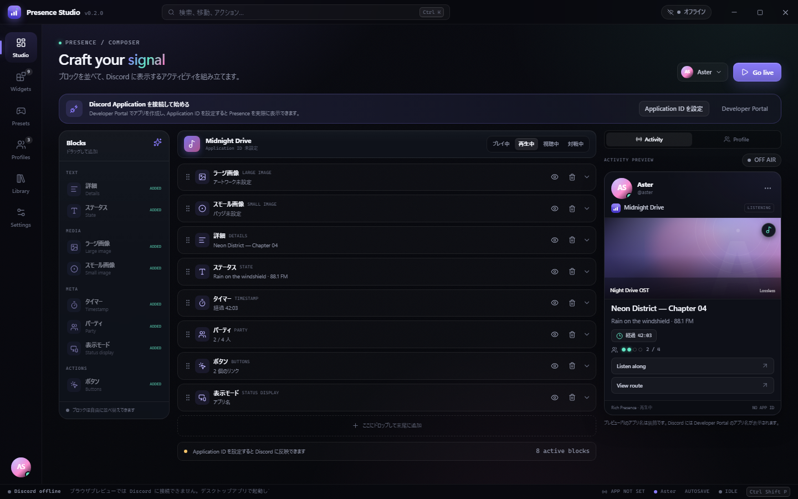
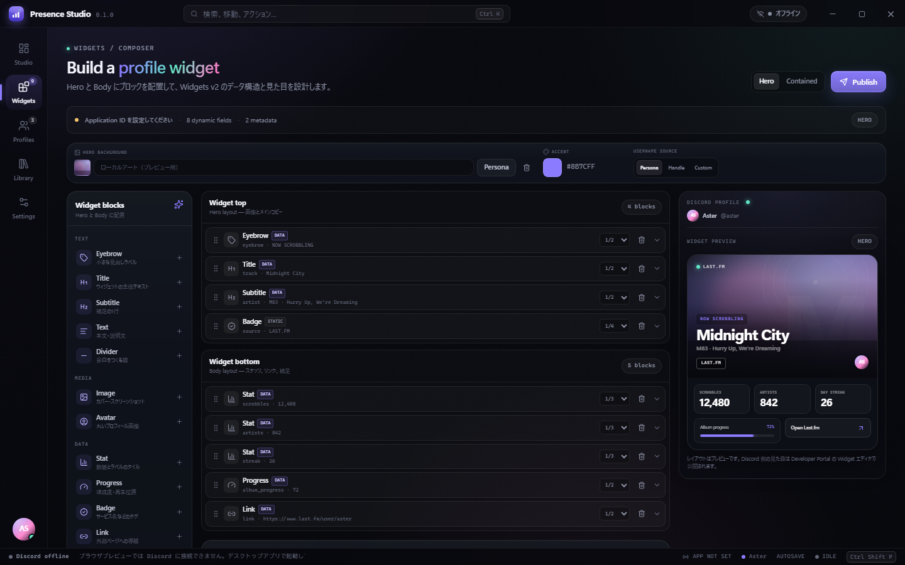
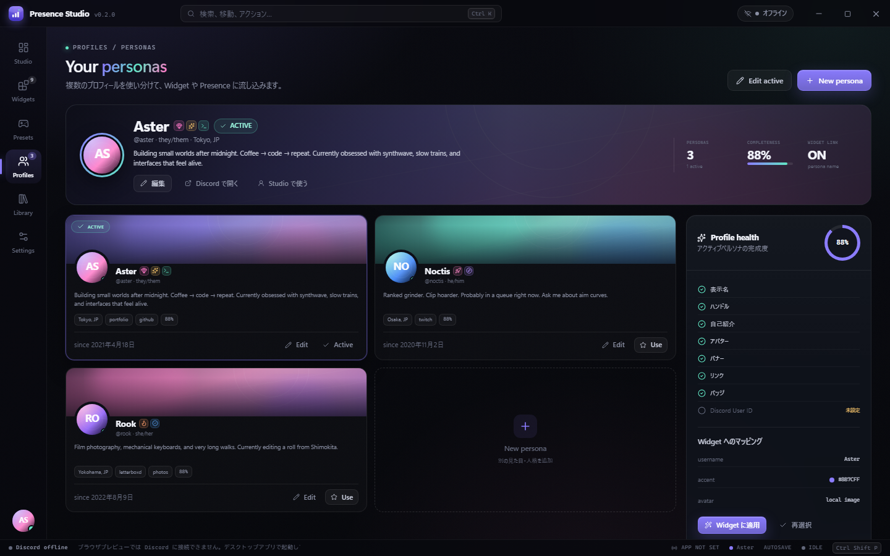
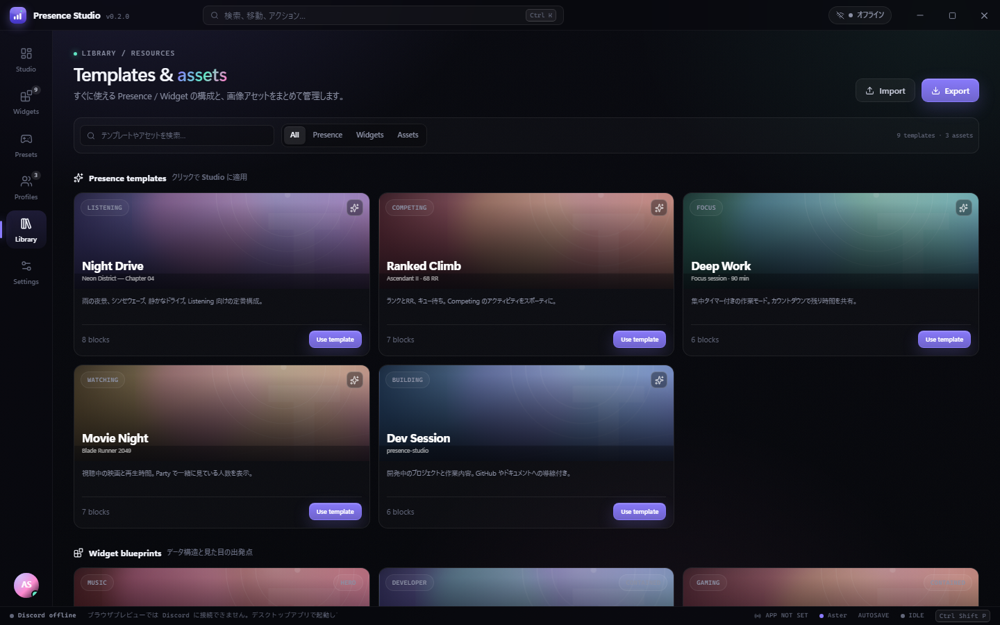
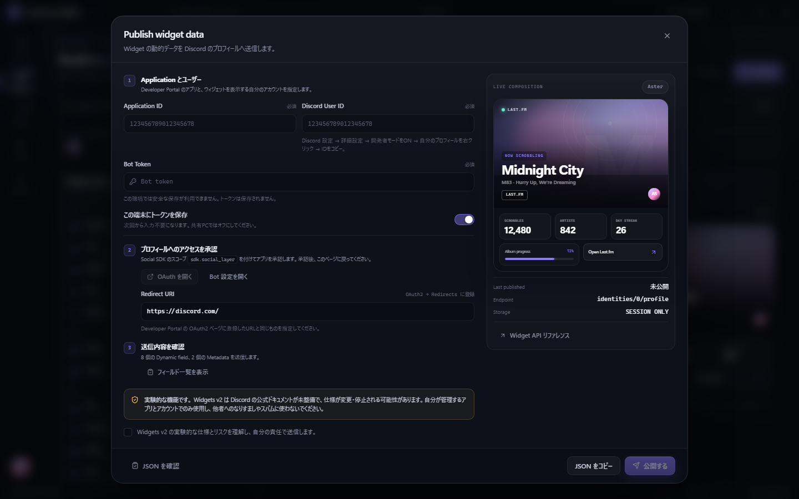
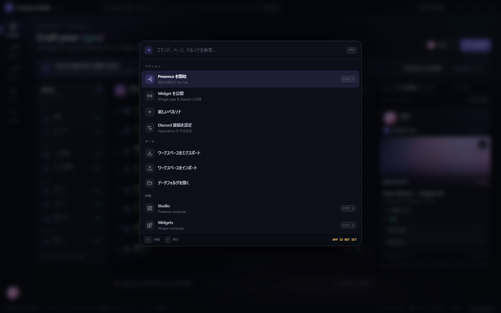
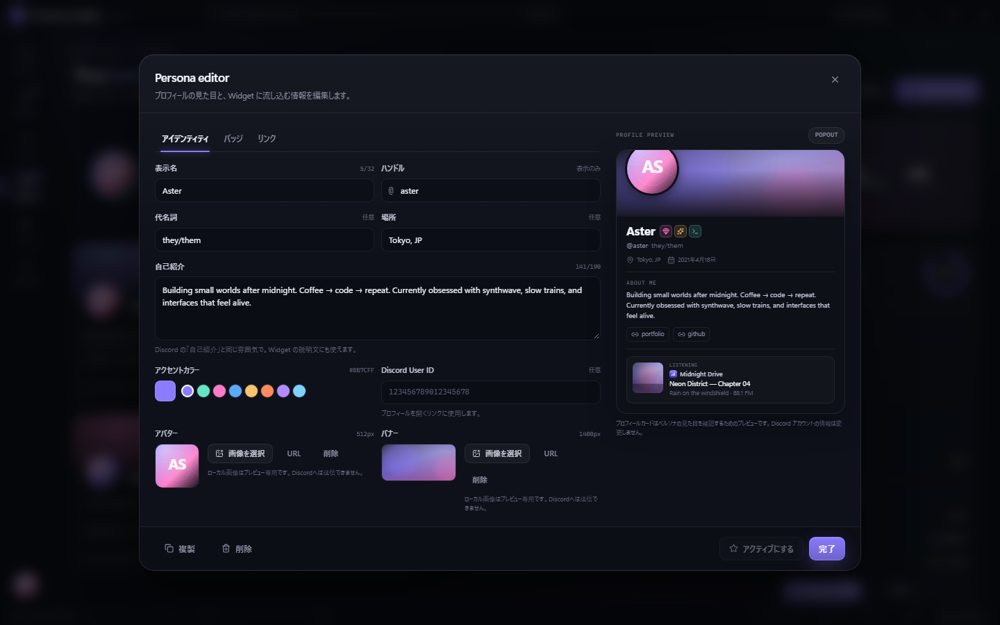
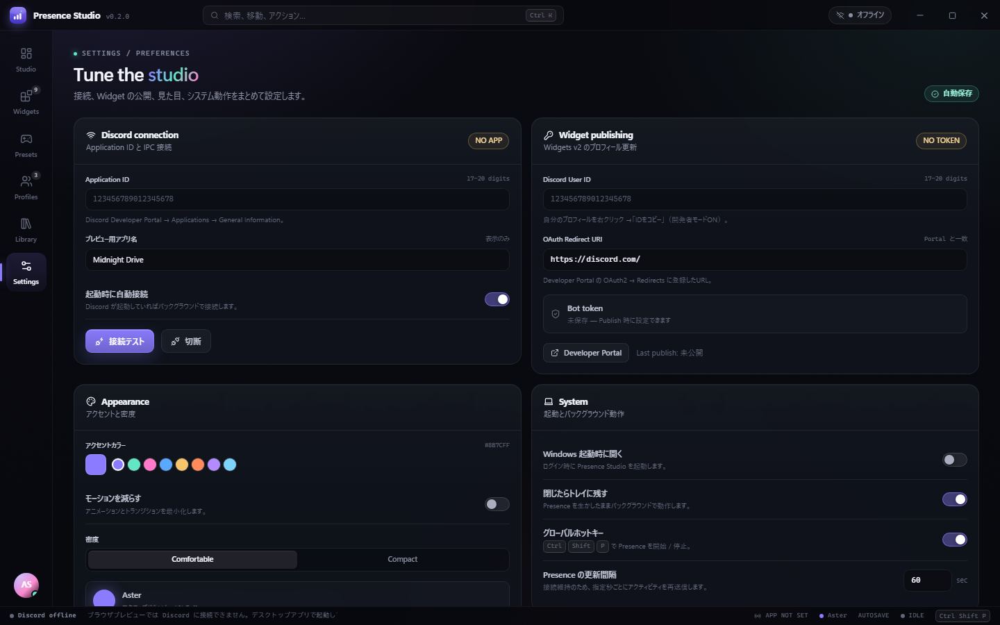

# Presence Studio

> A desktop studio for composing Discord Rich Presence, profile widgets, and personas.

**Discord の Rich Presence・プロフィール Widget・ペルソナを、ひとつの画面で組み立てる Windows デスクトップアプリ。**

[](https://github.com/4uthen7/presence-studio/releases/latest)
[](#動作環境)
[](LICENSE)
[](#presence)

<p align="center">
  <a href="https://github.com/4uthen7/presence-studio/releases/latest">
    
  </a>
</p>



Presence Studio は、Discord のアクティビティ表示（Rich Presence）を
**ブロックをドラッグ＆ドロップするだけ**で作れるツールです。
Client ID・画像・パーティ人数・ボタン・タイマーをひとつの画面で編集し、
Discord での見え方をその場で確認できます。

さらに、Discord の新しいプロフィール **Widgets v2** のデータ編集・プレビュー・公開、
複数のプロフィール（ペルソナ）の管理、テンプレートやアセットの再利用にも対応しています。

> 本アプリは Discord Inc. の公式クライアントではありません。個人が開発した非公式ツールです。

## こんな人におすすめ

- Discord の「Playing / Listening」表示を自分好みにカスタマイズしたい
- Advanced-DiscordRPC のような RPC ツールを、もっと扱いやすい UI で使いたい
- 画像・ボタン・パーティ・タイマーを、実際の表示を見ながら設定したい
- Widgets v2 のデータを、JSON を手で書かずにプレビューしながら公開したい
- 複数のプロフィール（ペルソナ）を素早く切り替えたい

## 主な機能

### Presence

- 詳細 / ステータス / ラージ画像 / スモール画像 / タイマー / パーティ / ボタン / 表示モードを
  **ブロックとして追加・並べ替え**
- Discord デスクトップアプリへ **ローカル IPC で直接接続**
- `Go live` / `Stop presence`、接続状態、自動再接続
- Discord 風アクティビティカードでリアルタイムプレビュー
- 入力値のバリデーション（文字数・URL・画像ソース・パーティ人数など）
- トレイ常駐、グローバルホットキー `Ctrl + Shift + P`、Windows 起動時の自動起動
- 変更内容は自動保存。JSON でバックアップ / 復元

### Widget Composer（Widgets v2）

- Discord のプロフィール Widget 用 **データペイロード**を設計・公開
- `Hero` / `Contained` レイアウトのプレビュー
- Hero / Body の2ゾーンにブロックをドラッグ＆ドロップ
  - Eyebrow / Title / Subtitle / Text
  - Image / Avatar
  - Stat / Progress / Badge / Link / Divider
- Dynamic Data Field、サンプル値、Metadata（最大25件）、Primary fields
- **Publish** パネルから Discord API へ送信
- Bot Token は Windows の DPAPI で暗号化して保存（エクスポートには含まれません）
- Hero 背景・アクセントカラー・Username ソースをその場で変更

> Widget の「見た目のレイアウト」自体は Discord Developer Portal の Widget エディタで作成します。
> このアプリは、その Widget に流し込む **データ構造の設計・プレビュー・公開**を担当します。
> Portal 側の Data Field 名と、アプリ側の Data Field 名を一致させてください。

### Profiles / ペルソナ

- 複数のペルソナ（表示名・ハンドル・代名詞・自己紹介・場所・Discord User ID）
- アバター / バナー / アクセントカラー / バッジ / リンク
- Discord のプロフィールポップアウト風プレビュー
- プロフィール完成度チェック（Profile health）
- ペルソナを Widget の username / accent に適用
- Studio 右上からペルソナをクイック切り替え
- Discord のプロフィールを `discord://` で開く

> ペルソナはアプリ内の「見た目・Widget 用データ」です。
> Discord アカウントのプロフィールを直接書き換えるものではありません。

### Library / 操作感

- Presence テンプレート 5種（Night Drive / Ranked Climb / Deep Work / Movie Night / Dev Session）
- Widget ブループリント 4種（Last.fm / GitHub / Valorant / Study）
- Asset Key / 画像URL ライブラリ
- コマンドパレット（`Ctrl + K`）、`Ctrl + 1..5` で画面移動
- トースト通知、自動保存、ステータスバー
- フレームレスのカスタムタイトルバー

## はじめかた

### 1. ダウンロード

[**Latest Release**](https://github.com/4uthen7/presence-studio/releases/latest) から
`Presence-Studio-0.1.0-win64.zip` をダウンロードしてください。

ZIP を右クリック →「すべて展開」→ フォルダ内の **`Presence Studio.exe`** を実行します。
インストールは不要です。

> コード署名を行っていないため、初回起動時に Windows SmartScreen の警告が出る場合があります。
> 「詳細情報」→「実行」を選択してください。

### 2. Discord Application ID を用意する

1. [Discord Developer Portal](https://discord.com/developers/applications) を開く
2. **New Application** でアプリを作成
3. **General Information** の **Application ID** をコピー
4. Presence Studio 右上の接続ピル、または Studio 画面の
   「Application ID を設定」から ID を貼り付け

### 3. Discord に表示する

Discord デスクトップアプリを起動した状態で、

1. **接続テスト** を押す
2. **Go live** を押す
3. プロフィールにアクティビティが表示される

ブラウザ版 Discord では動作しません。**Discord デスクトップアプリ**が必要です。

### 画像を使う場合

- **Asset Key**: Developer Portal → 対象アプリ → **Rich Presence → Art Assets** に画像をアップロードし、
  キー名を Presence Studio に入力
- **URL**: `https://…` の外部URLも指定できますが、Discord 側の仕様により表示されない場合があります
- ローカル画像はプレビュー専用です。Discord へは送信されません（UI にも警告が出ます）

## Widgets v2 を使う場合

Widgets v2 は 2026 年時点で実験的な機能です。次の準備が必要です。

1. Developer Portal でアプリを作成し、**Games → Social SDK** を有効化
2. Widget エディタで **Widget Top / Widget Bottom / Widget Preview** を作成し、
   Data Field 名を決めて **Publish**
3. **OAuth2** で Redirect URI を登録し、`openid` と `sdk.social_layer` のスコープでアプリを承認
4. **Bot** タブで Bot Token を取得
5. Presence Studio の **Widgets → Publish** で
   Application ID / User ID / Bot Token を入力して公開

Widget をプロフィールに追加する操作は、Discord 側の実験フラグや API が必要です。
本アプリはデータの公開までを担当します。

> Widgets v2 は仕様変更・停止の可能性があります。自分が管理するアプリ／アカウントで、
> 自己責任で使用してください。他者へのなりすましやスパム目的の使用は禁止です。

## スクリーンショット

| Presence | Widgets |
| --- | --- |
|  |  |

| Profiles | Library |
| --- | --- |
|  |  |

| Publish | Command palette |
| --- | --- |
|  |  |

| Persona editor | Settings |
| --- | --- |
|  |  |

## よくある質問

### Discord に何も表示されない

- Discord **デスクトップアプリ**が起動しているか確認してください（ブラウザ版は不可）
- Application ID が正しいか確認してください
- **接続テスト**が成功しているか確認してください
- **Go live** を押しているか確認してください
- 詳細・ステータス・画像のいずれかが入力されているか確認してください

### 画像が表示されない

- **Asset Key** を使う場合、Developer Portal の **Rich Presence → Art Assets** に
  同じキー名で画像をアップロードしてください
- 外部URLは Discord 側で取得できない場合があります
- ローカル画像はプレビュー専用です

### Discord のプロフィール（バナー・バッジ）は変わる？

いいえ。ペルソナは Presence Studio 内のプレビュー用データです。
Discord アカウントのプロフィールを直接変更する機能はありません。

### 配信（Streaming）にできない

Discord RPC の仕様上、Streaming アクティビティには制限があります。
本アプリでは **Playing / Listening / Watching / Competing** を提供しています。

### Bot Token は安全？

Bot Token は Windows の DPAPI（Electron `safeStorage`）で暗号化して保存され、
エクスポート JSON には含まれません。共有PCでは「この端末に保存」をオフにしてください。

### アンインストールしたい

ZIP を展開したフォルダを削除してください。
設定・ワークスペースも消す場合は `%APPDATA%\Presence Studio` を削除してください。

## 動作環境

- Windows 10 / 11（x64）
- Discord デスクトップアプリ
- インターネット接続（Widget の公開時）

## データとプライバシー

- ワークスペース: `%APPDATA%\Presence Studio\presence-studio.json`
- Bot Token: `%APPDATA%\Presence Studio\secrets.json` に DPAPI で暗号化
- RPC はローカルの名前付きパイプのみ使用
- 外部通信は Discord API への Widget 公開時のみ
- Bot Token はエクスポートに含まれません

## 開発

Node.js 22.12 以上が必要です。

```powershell
npm install
npm run dev
```

本番ビルド:

```powershell
npm run build
npm run package      # ポータブルEXE
# または
npm run package:dir  # release/win-unpacked/Presence Studio.exe
```

ブラウザプレビュー（Electron なしで UI を確認）:

```powershell
npm run build
npm run preview:web  # http://127.0.0.1:4173
```

構成・RPC の実装・Widgets v2 の API 仕様などの技術的な詳細は
[docs/DEVELOPMENT.md](docs/DEVELOPMENT.md) を参照してください。

### 技術スタック

- Electron 45 / React 19 / TypeScript / Vite
- Zustand
- dnd-kit
- Discord IPC（HANDSHAKE / SET_ACTIVITY を直接実装）
- Discord API v9（Widgets v2 のデータ公開）

## 制限・注意

- Discord の **Streaming** アクティビティは RPC の仕様上制限があるため未対応です
- プロフィールの見た目（バナー・バッジ等）はプレビュー用です
- Widgets v2 は実験的機能です。Discord クライアントのバージョンや実験フラグにより挙動が変わります
- コード署名を行っていないため、配布時に SmartScreen の警告が出ることがあります
- Discord Inc. とは無関係の非公式ツールです

## クレジット / 参考

- [Advanced-DiscordRPC](https://github.com/iseizuu/Advanced-DiscordRPC) — 元になった発想
- [Discord RPC documentation (Userdoccers)](https://docs.discord.food/topics/rpc)
- [Discord Widgets documentation (Userdoccers)](https://docs.discord.food/resources/widgets)
- [How to Build Discord Profile Widgets — Rohan](https://www.rohan.run/writing/discord-widgets)
- [Discord Widgets v2 の日本語メモ — Qiita](https://qiita.com/AmaseCocoa/items/1268a0a30dc2405d0e93)

## License

[MIT](LICENSE)
